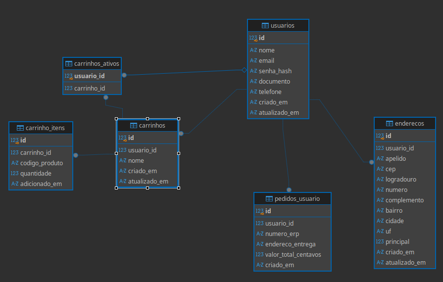

# Relatório de entrega

> Preencha este arquivo e entregue junto com o código. Ele é lido antes do
> código e serve de base para a conversa de devolutiva.
>
> **Escreva direto.** Frase curta vale mais que parágrafo bonito. Se alguma
> seção não se aplica, escreva "não se aplica" e siga — deixar em branco deixa
> a dúvida se você pulou ou se esqueceu.
>
> Apague estas instruções em itálico conforme for preenchendo.

**Candidato:**
**Data de entrega:**
**Tempo aproximado dedicado:**

---

## 1. Subindo o projeto

*Como você colocou a aplicação no ar? O que foi mais difícil ou confuso?*

*Precisou criar algum arquivo que não estava no repositório? Qual?*

---

## 2. Chamados reportados

Um bloco por chamado. **Causa** é o que estava errado no código, não o sintoma
que o cliente descreveu.

### KZN-312 — Total do carrinho vem maior que a soma das peças

| | |
|---|---|
| **Causa** | O item sem estoque era marcado como indisponível, mas seu valor ainda entrava no total do carrinho. |
| **Como reproduzi** | Radiador `ARR-7002` já no carrinho, com preço de R$ 684,00 e estoque zero no ERP. Esse valor era somado mesmo com o aviso de indisponibilidade. |
| **Arquivos alterados** | `backend/src/services/carrinhoService.js` e `frontend/src/paginas/Carrinho.jsx`. Adicionei `frontend/src/componentes/ModalPendencias.jsx`. |
| **Como validei a correção** | Adicionei um script SQL que permitia para incluir produtos  no carrinho sem estoque, e backend estava calculando o preço de itens que não estavam mais disponíveis também implementei um modal para alertar o usuário sobre esses produtos indisponíveis ou sem estoque |

Agora, itens indisponíveis têm subtotal zero. O preço unitário e o aviso
continuam visíveis. Também adicionei um modal que mostra os itens com pendência
e permite removê-los antes de seguir para o checkout. O modal ficou em um
componente separado, com os textos recebidos por props.

Trecho revisado: `KZN-7F3A`.

### KZN-318 — Número no ícone do carrinho está errado

| | |
|---|---|
| **Causa** | `quantidade_pecas` usava `itens.length`, contando os produtos diferentes sem considerar quantas unidades havia de cada um. |
| **Como reproduzi** | Carrinho com dois produtos, um com 3 unidades e outro com 4. O contador mostrava 2, embora houvesse 7 peças. |
| **Arquivos alterados** | `backend/src/services/carrinhoService.js`. |
| **Como validei a correção** | Conferi o retorno do serviço com 3 + 4 unidades: retornou 7 peças. Também conferi o carrinho vazio, que retornou zero. |

Agora, `quantidade_pecas` soma as unidades de cada produto. Mantive
`quantidade_itens` e adicionei `quantidade_produtos` para informar quantos
produtos diferentes estão no carrinho. O ícone e o resumo já usam
`quantidade_pecas`.

### KZN-325 — Busca diz que não encontrou peça que existe

| | |
|---|---|
| **Causa** | A busca mantinha a página anterior na URL. Se os resultados da pesquisa tinham menos páginas, a consulta retornava vazia mesmo com produtos encontrados. O mesmo acontecia ao mudar os filtros. |
| **Como reproduzi** | Acessar `/?pagina=2` e pesquisar "agua" olhando para requisição enviado apra backend.  A busca continuava pedindo a página 2, em vez de começar na primeira página dos resultados. |
| **Arquivos alterados** | `frontend/src/componentes/Cabecalho.jsx` e `frontend/src/paginas/Catalogo.jsx`. |
| **Como validei a correção** | Conferi as URLs geradas ao pesquisar, limpar a busca e mudar categoria ou filtro de estoque.  |

Agora, pesquisar ou mudar um filtro remove `pagina` da URL e volta para a
página 1. Os outros filtros continuam aplicados.

Trecho revisado: `KZN-5D1E`.

### KZN-331 — Pedido saiu com o endereço errado

| | |
|---|---|
| **Causa** | Ao enviar o pedido, o checkout buscava o endereço principal e ignorava o endereço escolhido na tela. |
| **Como reproduzi** | Casa como endereço principal e Oficina como outro endereço. Mesmo selecionando Oficina, o checkout enviava o ID da Casa. |
| **Arquivos alterados** | `frontend/src/paginas/Checkout.jsx`. |
| **Como validei a correção** | Simulei a seleção de Casa, Oficina e um novo endereço e conferi o `endereco_id` enviado em cada caso. |

Agora, o pedido usa `enderecoId`, que guarda o endereço selecionado pelo
cliente. O principal fica apenas como seleção inicial do checkout.

---

## 3. Problemas que encontrei por conta própria

*Os chamados não cobrem tudo. Liste aqui o que você encontrou sozinho —
inclusive o que decidiu **não** corrigir. Repita o bloco quantas vezes precisar.*

*Achar e documentar um problema conta a favor mesmo sem a correção. Deixar de
relatar algo que você viu conta contra.*/

### Problema 1

| | |
|---|---|
| **O que está errado** | |
| **Como cheguei nele** | |
| **Impacto** | *quem é afetado e como* |
| **Corrigi?** | sim / não — e por quê |
| **Arquivos alterados** | |

### Problema 2

| | |
|---|---|
| **O que está errado** | |
| **Como cheguei nele** | |
| **Impacto** | |
| **Corrigi?** | |
| **Arquivos alterados** | |

### Problema 3

| | |
|---|---|
| **O que está errado** | |
| **Como cheguei nele** | |
| **Impacto** | |
| **Corrigi?** | |
| **Arquivos alterados** | |

---

## 4. Múltiplos carrinhos

### Como ficou

Adicionei a opção de criar, renomear, trocar e excluir carrinhos. O cliente
pode manter, por exemplo, "Gol do João" e "Civic prata", cada um com suas peças
e quantidades. O carrinho selecionado fica salvo para quando ele voltar.

Os controles ficaram em `GerenciadorCarrinhos.jsx`, na tela do carrinho,
inclusive quando ele está vazio. A exclusão pede confirmação. Também separei
o `Modal.jsx` para usar tanto nessa confirmação quanto nas pendências de estoque.

### Modelagem

Antes, cada item estava ligado direto ao usuário. Agora, o usuário tem vários
carrinhos e cada item pertence a um deles.

| Tabela | Como ficou |
|---|---|
| `carrinhos` | Guarda `id`, `usuario_id`, `nome`, `criado_em` e `atualizado_em`. O nome tem até 80 caracteres e não pode se repetir para o mesmo usuário. |
| `carrinhos_ativos` | Guarda `usuario_id` como chave primária e `carrinho_id`. Assim, cada usuário tem no máximo uma seleção salva. |
| `carrinho_itens` | Troquei `usuario_id` por `carrinho_id`. A combinação única passou a ser carrinho + código do produto. A mesma peça pode estar em carrinhos diferentes com quantidades diferentes. |

Escolhi guardar o ativo em uma tabela separada para trocar a seleção sem
alterar os outros carrinhos. A chave composta de `carrinhos_ativos` também
garante que o carrinho selecionado pertence ao usuário. Seria possível usar
uma coluna `ativo` em `carrinhos`, mas ela precisaria de uma regra para impedir
dois ativos ao mesmo tempo.

### Migração dos dados existentes

Atualizei `aplicarSchema()` em `backend/src/db/index.js` para aproveitar os
dados que já estavam no banco. A função identifica a tabela antiga pela
coluna `usuario_id`, cria um "Meu carrinho" para cada usuário e copia os itens
para ele, mantendo IDs, códigos, quantidades e datas.

A tabela antiga só é removida depois de conferir que todos os itens foram
copiados. Isso roda em uma transação: se falhar, as mudanças são desfeitas.
Usuários, endereços e pedidos existentes são mantidos.

A função roda ao iniciar o backend e ao executar `npm run db:init`. A cópia
dos itens antigos acontece só na primeira migração. Nas próximas vezes,
`IF NOT EXISTS` e `WHERE NOT EXISTS` evitam duplicações. Em produção, é preciso
fazer backup e parar o backend antigo antes da atualização, porque ele ainda
consulta a coluna `usuario_id` dos itens.

### APIs novas e alteradas

Mantive as rotas juntas em `backend/src/routes/carrinho.js`. As operações de
itens usam `criarRotasItensCarrinho()` nas duas versões da API, aproveitando
as mesmas validações.

| Método | Rota | O que faz |
|---|---|---|
| GET | `/api/carrinhos` | Lista os carrinhos do usuário, suas quantidades e o ID do ativo. |
| POST | `/api/carrinhos` | Cria um carrinho com `{ "nome": "Gol do João" }` e já o seleciona. |
| PATCH | `/api/carrinhos/:id` | Renomeia o carrinho, recebendo `nome`. |
| PUT | `/api/carrinhos/:id/ativo` | Seleciona o carrinho para receber as próximas peças. |
| DELETE | `/api/carrinhos/:id` | Exclui o carrinho e seus itens. |
| GET | `/api/carrinhos/:id` | Retorna os itens, preços, total e pendências desse carrinho. |
| POST | `/api/carrinhos/:id/itens` | Adiciona uma peça com `codigo_produto` e `quantidade`. |
| PATCH | `/api/carrinhos/:id/itens/:codigo` | Altera a quantidade da peça nesse carrinho. |
| DELETE | `/api/carrinhos/:id/itens/:codigo` | Remove a peça desse carrinho. |
| DELETE | `/api/carrinhos/:id/itens` | Esvazia os itens e mantém o carrinho. |
| POST | `/api/pedidos` | Passou a receber `carrinho_id` junto com `endereco_id` e `observacao`. Fecha o pedido do carrinho ativo informado. |

As rotas antigas `/api/carrinho`, `/api/carrinho/itens` e
`/api/carrinho/itens/:codigo` continuam usando o carrinho ativo. O retorno do
carrinho ganhou `id`, `nome`, `carrinhos` e `carrinho_ativo_id`.

No frontend, atualizei `api/cliente.js` para enviar o ID nas operações de
itens. No checkout, se `carrinho_id` não vier ou vier como `null`, o backend usa
o ativo. Se vier um ID de outro usuário ou que não existe, retorna 404. Se
o carrinho informado já não for o ativo, retorna 409 para o cliente conferir
os itens antes de fechar o pedido.

### Isolamento

As rotas exigem login. Antes de ler ou alterar um carrinho, o serviço confere
se o `id` pertence ao `usuario_id` da sessão. As consultas dos itens filtram
por `carrinho_id`, então a quantidade de uma lista não altera a outra.

O ID do destino é definido antes da consulta ao ERP e usado até o fim da
operação. Trocar de carrinho enquanto a resposta demora não manda a peça para
outra lista nem apaga outro carrinho no checkout. No frontend, trocar de conta
descarta o estado anterior, e respostas antigas não substituem a seleção atual.

## 6. Decisões e suposições

*Algo que o enunciado não respondia e você assumiu? Registre aqui.*

*Discordou de alguma coisa que já estava no projeto? O que faria diferente?*

---

## 7. O que faria com mais tempo

*O que ficou de fora, em ordem do que você atacaria primeiro.*

1.
2.
3.

---

## 8. Outras observações

*Espaço livre. Qualquer coisa que você queira registrar e que não coube acima.*

